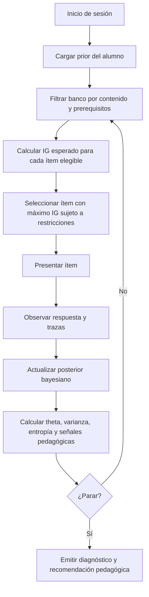
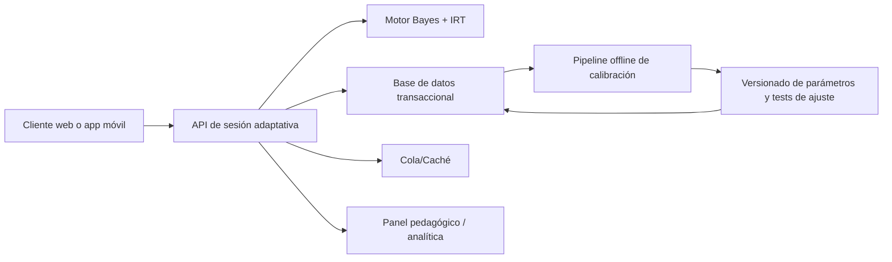

# Implementación rigurosa de una metodología adaptativa bayesiana con IRT 3PL en aplicaciones educativas

## Resumen ejecutivo

La combinación de inferencia bayesiana con teoría de respuesta al ítem y, en particular, con el modelo logístico de tres parámetros \(3PL\), es técnicamente viable y está bien alineada con la lógica de los test adaptativos informatizados: mantener una distribución posterior sobre el estado del alumno, actualizarla tras cada respuesta y seleccionar el siguiente ítem según el valor informativo esperado. En la literatura de CAT, este enfoque se asocia con mejoras de eficiencia respecto a pruebas lineales, siempre que exista un banco de ítems calibrado, control de exposición y un criterio de parada bien definido. El rasgo que hace útil a IRT en operación es precisamente que sitúa habilidades e ítems en la misma escala, permitiendo ajustar la dificultad y estimar precisión durante la sesión. citeturn23search0turn37view0turn7search0

Para una app educativa real, la decisión técnica más importante no es solo “usar Bayes + 3PL”, sino **cómo representar el estado latente**. La opción más robusta para un primer prototipo es una malla discreta de valores de habilidad \( \theta \) o un conjunto finito de hipótesis pedagógicas, porque simplifica la actualización posterior, la entropía de Shannon y la selección por ganancia de información. Esa versión es suficientemente rápida para navegador o servidor. Cuando el producto exige varias competencias simultáneas, longitudinalidad, respuesta politómica, o calibración continua con muchos usuarios, conviene pasar a modelos multidimensionales, jerárquicos o dinámicos, y usar EM/MML para calibración y VI o MCMC para ajuste offline. citeturn5search0turn8search0turn8search1turn9search2turn13search6

El mayor riesgo técnico está en el parámetro de pseudoazar \(c\) del \(3PL\). La bibliografía clásica y moderna coincide en que es el parámetro más frágil: puede quedar pobremente identificado, requerir muestras grandes y producir estimaciones espurias en poblaciones heterogéneas. Por eso, en un MVP es razonable fijar \(c_q = 1/m_q\) en ítems de opción múltiple o restringirlo a un intervalo pequeño, y reservar la estimación libre de \(c\) para fases posteriores con más datos y mejor control psicométrico. Si el banco aún no está bien calibrado, un \(2PL\) o una variante más parsimoniosa puede ser mejor decisión operativa que un \(3PL\) plenamente libre. citeturn21search6turn21search9turn21search3turn21search4

Desde el punto de vista de software, una **app estática** en HTML/JS o una PWA sí puede ejecutar la inferencia online, guardar trazas locales y funcionar offline mediante *service workers* e IndexedDB. Eso la hace adecuada para demos, pilotos internos, simuladores y actividades de baja criticidad. Sin embargo, una app puramente cliente no es la mejor opción cuando hay que proteger el banco de ítems, auditar decisiones, recalibrar con datos agregados, controlar exposición entre usuarios o cumplir de manera sólida con requisitos de privacidad, seguridad y trazabilidad. Para producción, suele bastar un monolito servidor al inicio; el salto a microservicios solo compensa cuando crecen el banco, los dominios, la telemetría y el pipeline de calibración. citeturn16search1turn16search9turn1search6turn27search0turn26search0turn17search1turn30search3turn31search1

Mi recomendación práctica para un primer producto mínimamente viable es esta: banco de ítems calibrado offline, inferencia online sobre una rejilla discreta de \( \theta \), \(3PL\) con \(c\) fijado o acotado, selección por ganancia esperada de información basada en entropía, parada por combinación de entropía, número máximo de ítems y mejora predictiva marginal, y una arquitectura monolítica simple con PostgreSQL para metadatos y trazas. R y Python siguen siendo los ecosistemas más maduros para calibración psicométrica; JavaScript es perfectamente válido para la capa de sesión y presentación, pero no es donde hoy está el ecosistema más sólido de IRT/CAT. citeturn11search4turn11search0turn14search1turn15search0turn15search1turn14search0turn28search5

## Núcleo metodológico e implementación paso a paso

La implementación más estable para una app educativa consiste en distinguir entre **calibración offline** y **inferencia online**. En la calibración offline se estiman los parámetros de ítems \(a_q\), \(b_q\) y, si procede, \(c_q\), junto con verificaciones de ajuste y calidad del banco. En la inferencia online, durante la sesión del alumno, esos parámetros se tratan como conocidos y se actualiza solamente la distribución del estado del alumno tras cada respuesta. Esta separación es estándar porque el ajuste de parámetros de ítems es mucho más costoso y sensible que la actualización secuencial del posterior del alumno. citeturn5search0turn37view0turn23search10

La forma más sencilla de representar el estado latente es una rejilla discreta \( \Theta = \{\theta_1,\dots,\theta_K\} \) o un conjunto finito de categorías pedagógicas \(H=\{h_1,\dots,h_K\}\). Si se usa rejilla de habilidad, cada hipótesis \(h_k\) equivale a un punto \( \theta_k \). Si se usan categorías como “básico, medio, avanzado”, puede asignarse a cada una un valor numérico central para usar IRT y conservar, a la vez, la interpretación pedagógica. Esto permite aplicar Bayes exactamente, sin optimización numérica compleja en cada paso. citeturn7search0turn13search0

El modelo \(3PL\) para un ítem \(q\) y una hipótesis \( \theta_k \) puede escribirse como:

\[
P(X=1 \mid \theta_k, q)=c_q+(1-c_q)\frac{1}{1+\exp\left[-a_q(\theta_k-b_q)\right]}
\]

donde \(a_q\) es discriminación, \(b_q\) dificultad y \(c_q\) pseudoazar o asintota inferior. La probabilidad de fallo es simplemente:

\[
P(X=0 \mid \theta_k, q)=1-P(X=1 \mid \theta_k, q)
\]

Esta verosimilitud es lo que Bayes necesita para actualizar la distribución posterior tras una respuesta observada. En ítems de opción múltiple, una parametrización inicial razonable es \(c_q = 1/m_q\), siendo \(m_q\) el número de opciones, aunque en bancos maduros puede estimarse o regularizarse. citeturn21search5turn21search6turn21search4

Si al inicio no se dispone de información adicional, el prior puede ser uniforme:

\[
p_0(\theta_k)=\frac{1}{K}
\]

Si sí existen señales previas —curso, edad, sesiones anteriores, tema ya trabajado— conviene usar un prior empírico con mezcla conservadora:

\[
p_0(\theta)=\lambda\,p_{\text{emp}}(\theta \mid z)+(1-\lambda)\,p_{\text{base}}(\theta), \qquad 0\le \lambda \le 1
\]

La razón para mezclar y no sustituir totalmente el prior base es que los priors empíricos mejoran eficiencia, pero si están sesgados pueden alargar el test o empujar el posterior en una dirección equivocada; por eso la literatura reciente recomienda usarlos con cautela, con poca rigidez o imponiendo un número mínimo de ítems antes de decisiones fuertes. citeturn23search1

La actualización bayesiana incremental, tras observar la respuesta \(x_t \in \{0,1\}\) al ítem \(q_t\), es:

\[
p_t(\theta_k)=\frac{P(x_t \mid \theta_k,q_t)\,p_{t-1}(\theta_k)}
{\sum_{j=1}^{K}P(x_t \mid \theta_j,q_t)\,p_{t-1}(\theta_j)}
\]

En producción conviene usar la versión logarítmica para evitar *underflow* numérico:

\[
\log \tilde p_t(\theta_k)=\log p_{t-1}(\theta_k)+
x_t \log \pi_{kq_t} + (1-x_t)\log(1-\pi_{kq_t})
\]

donde \( \pi_{kq_t}=P(X=1\mid \theta_k,q_t)\). Después se normaliza con *log-sum-exp*:

\[
p_t(\theta_k)=\frac{\exp(\log \tilde p_t(\theta_k)-M)}
{\sum_{j=1}^K \exp(\log \tilde p_t(\theta_j)-M)}
\]

siendo \(M=\max_j \log \tilde p_t(\theta_j)\). Esta es la forma recomendada si la sesión puede durar muchas preguntas o si hay ítems muy informativos. citeturn7search0turn13search0

Una vez actualizado el posterior, la app puede calcular estadísticas útiles para la interfaz y para la lógica de decisión. La media posterior:

\[
\hat\theta_t=\sum_{k=1}^{K}\theta_k\,p_t(\theta_k)
\]

y la varianza posterior:

\[
\operatorname{Var}_t(\theta)=\sum_{k=1}^{K}(\theta_k-\hat\theta_t)^2\,p_t(\theta_k)
\]

permiten resumir el nivel estimado y su incertidumbre. Si el producto trabaja con categorías en lugar de una escala continua, bastará con mostrar \( \arg\max_k p_t(\theta_k) \) y su probabilidad asociada. citeturn4search10turn23search10

Para medir incertidumbre de manera explícita es útil la entropía de Shannon:

\[
\mathcal H_t=-\sum_{k=1}^{K}p_t(\theta_k)\log_2 p_t(\theta_k)
\]

Si las probabilidades están muy repartidas, \( \mathcal H_t \) será alta; si una hipótesis domina claramente, \( \mathcal H_t \) será baja. En un sistema adaptativo, la selección del siguiente ítem no debería basarse solo en “subir o bajar dificultad”, sino en maximizar la reducción esperada de esta incertidumbre. Ese planteamiento entronca con los criterios bayesianos de selección de ítems y con criterios de varianza posterior predictiva usados en CAT. citeturn7search0turn6search1turn25search8

La ganancia esperada de información del ítem candidato \(q\) puede escribirse como:

\[
IG_t(q)=\mathcal H_t-\sum_{x\in\{0,1\}}P(x\mid q,\mathcal D_t)\,
\mathcal H\!\left(p(\theta\mid \mathcal D_t,q,x)\right)
\]

donde la probabilidad predictiva de respuesta es:

\[
P(x\mid q,\mathcal D_t)=\sum_{k=1}^{K}P(x\mid \theta_k,q)\,p_t(\theta_k)
\]

y \( \mathcal D_t \) denota el historial observado hasta el momento. El ítem óptimo es el que maximiza \(IG_t(q)\), posiblemente sujeto a restricciones de contenido, exposición o prerequisitos curriculares. Esta elección es conceptualmente muy cercana a otros criterios bayesianos como MEPV o máxima precisión posterior esperada. citeturn6search1turn7search0turn7search1

El criterio de parada debe ser compuesto. Una configuración muy razonable para un prototipo combina cuatro reglas: un mínimo de ítems, una incertidumbre suficientemente baja, una mejora marginal insuficiente y un máximo de ítems. Formalmente, por ejemplo:

\[
\mathcal H_t \le \tau_H
\quad \text{o} \quad
\operatorname{Var}_t(\theta)\le \tau_V
\quad \text{o} \quad
\max_q IG_t(q)\le \varepsilon
\quad \text{o} \quad
t\ge N_{\max}
\]

La literatura sobre CAT muestra que reglas basadas en error estándar mínimo o reducción predictiva esperada del error mejoran la eficiencia frente a reglas puramente fijas. Para una app educativa cotidiana, una buena práctica operativa es imponer además \(N_{\min}\), por ejemplo para amortiguar el efecto de un prior sesgado o de aciertos/errores fortuitos tempranos. citeturn6search1turn23search1

El flujo completo puede resumirse así:



Este diseño es coherente con los componentes estándar de los algoritmos CAT —selección, balance/restricciones y control de exposición— y con los criterios bayesianos de estimación secuencial. citeturn23search0turn6search0turn7search0

## Extensiones matemáticas y alternativas

La calibración de ítems es la parte psicométricamente delicada del sistema. El procedimiento clásico más extendido para parámetros de ítems en IRT es la máxima verosimilitud marginal con EM, introducida por Bock y Aitkin, porque integra sobre la distribución de habilidad y hace viable la estimación de modelos sin estadísticas suficientes simples. En términos prácticos, esto significa que la calibración del banco debe hacerse en lotes, con muestras amplias y procedimientos de control de ajuste, antes de usar el banco para decisiones adaptativas online. citeturn5search0

En \(3PL\), la estimación de \(c\) merece tratamiento especial. El problema no es solo computacional, sino de identificabilidad y estabilidad de errores estándar. La literatura muestra que la estimación del asintótico inferior puede degradar la precisión del parámetro de dificultad y volver inaceptables los tamaños muestrales requeridos en aplicaciones que dependen de parámetros individuales fiables, como el CAT o la equiparación. Además, en poblaciones heterogéneas puede aparecer “pseudoazar” espurio. Por ello, una práctica prudente en educación aplicada es **fijar** \(c\), compartirlo por familia de ítems o estimarlo con prior informativo fuerte en lugar de dejarlo completamente libre en fases tempranas. citeturn21search6turn21search3turn21search9

El diseño de la muestra de calibración también importa. Para calibrar bien ítems de 2PL y 3PL no basta con “más respuestas”: conviene que la distribución de habilidad de los examinados sea amplia, porque los distintos parámetros del ítem se recuperan mejor cuando hay información desde varios niveles del rasgo. Esto es especialmente importante si el banco va a servir a usuarios muy heterogéneos o si luego se quiere hacer selección adaptativa de precisión razonable en extremos de la escala. citeturn21search0

Los modelos jerárquicos bayesianos son una mejora útil cuando el banco es pequeño, hay pocos datos por ítem o se desea compartir información entre dominios, cursos o familias de preguntas. El beneficio principal es el *shrinkage*: parámetros extremos o mal informados “vuelven” hacia distribuciones poblacionales más plausibles. El coste es que pueden introducir sesgo si la estructura jerárquica está mal especificada o si el agrupamiento no refleja la realidad del banco. En muestras pequeñas, no obstante, la literatura reciente y aplicada muestra que los modelos jerárquicos pueden recuperar mejor parámetros que enfoques puramente no jerárquicos. citeturn8search2turn8search7turn21search10

En cuanto a inferencia, hay tres familias con papeles distintos. **MCMC/NUTS** es excelente para calibración offline y auditoría del modelo porque ofrece distribuciones posteriores ricas y diagnósticos de convergencia; PyMC y Stan lo soportan oficialmente. **Variational inference** es mucho más rápida y, en IRT, ha mostrado rendimientos competitivos en varios escenarios; además, hoy es la base de librerías prácticas como py-irt. **Filtros secuenciales / particle filters** son especialmente atractivos cuando la habilidad cambia con el tiempo, porque permiten tratar \( \theta_t \) como estado dinámico y hacer seguimiento online de aprendizaje o fatiga; aquí la evidencia relevante existe, pero en esta revisión una parte sustancial de las referencias localizadas es preprint o está orientada a investigación más avanzada, por lo que conviene considerarlo una línea prometedora más que una recomendación de primer despliegue. citeturn13search6turn12search0turn12search8turn9search2turn14search0turn10academia24turn9academia36

Si el dominio educativo es realmente multidimensional —por ejemplo, problemas matemáticos que también exigen comprensión verbal, o ejercicios que combinan procedimiento y concepto— la hipótesis de un único rasgo puede ser demasiado pobre. En ese caso conviene pasar a **MIRT**, ya sea compensatorio o no compensatorio, e incluso introducir una **Q-matrix** que explicite qué competencias activa cada ítem. La contrapartida es computacional: la integración EAP por cuadratura crece exponencialmente con el número de dimensiones, de modo que a partir de dos o tres dimensiones suelen ganar atractivo aproximaciones MAP, algoritmos estocásticos o VI. citeturn8search0turn4search10turn15search0

Para respuestas no binarias, el principio bayesiano es el mismo; cambia la verosimilitud. En tareas con categorías ordenadas convienen modelos como el **graded response model** de Samejima o el **partial credit model** de Masters. Para pasos secuenciales autocorregibles, rúbricas parciales o tareas con varios niveles de logro, estos modelos suelen ser más fieles que forzar un 0/1. Además, permiten convertir eventos como “solicita pista”, “corrige tras segundo intento” o “completa parcialmente” en evidencia probabilística más realista. citeturn18search0turn4search0turn36search8

Otra extensión importante es modelar el **aprendizaje durante la propia sesión**. El supuesto IRT clásico es independencia local y habilidad estable durante la prueba, pero en recursos formativos puede haber microaprendizaje entre ejercicios. La literatura reciente propone modelos explicativos bayesianos que incorporan aprendizaje dentro del test. Si se espera ese fenómeno, el sistema no debería interpretar toda mejora intra-sesión como evidencia de habilidad previa: parte puede ser aprendizaje inducido por la práctica o por *feedback*. citeturn9search3

El control de calidad del modelo no puede olvidarse. Violaciones de independencia local, testlets, pasajes compartidos o subdimensiones no modeladas pueden sesgar parámetros, sobreestimar información y dar una falsa sensación de certeza. Por eso es recomendable comprobar ajuste y dependencia local con técnicas de *posterior predictive model checking* o diagnósticos específicos, y usar modelos bifactor, testlet o jerárquicos cuando el diseño del ítem así lo requiera. citeturn32search0turn32search1turn8search1turn32search3

En equidad y validez, toda implantación seria debería incorporar análisis de **funcionamiento diferencial del ítem**. El DIF no es un detalle académico: puede desplazar puntuaciones esperadas, alterar comparabilidades entre grupos y contaminar decisiones educativas. Además, la literatura reciente subraya que en IA educativa y predicción algorítmica la justicia no se garantiza solo con precisión global; debe revisarse por subgrupos, umbrales y consecuencias. citeturn36search7turn36search1turn19search7

Como síntesis, las mejoras matemáticas recomendables por orden práctico serían: empezar con una rejilla discreta y \(3PL\) regularizado; pasar después a calibración MML/EM robusta; añadir priors empíricos suaves; incorporar modelos politómicos si el contenido lo pide; y dejar MIRT, filtros secuenciales o modelos dinámicos para una segunda fase, cuando ya existan datos suficientes, hipótesis pedagógicas claras y métricas operativas estables. citeturn5search0turn23search1turn8search0turn9search3

## Diseño de software, datos y arquitectura

La arquitectura del sistema debe reflejar la separación entre **serving online** y **analytics/calibración offline**. Un patrón muy efectivo para empezar es un monolito servidor con API HTTP, base de datos relacional y un pequeño módulo de scoring. Flask encaja bien cuando se busca simplicidad y control en Python: su documentación lo define como una aplicación WSGI y recuerda que el servidor de desarrollo no debe usarse en producción. Node.js encaja especialmente bien en flujos I/O intensivos, porque su modelo favorece operaciones no bloqueantes, y Express ofrece un direccionamiento claro por método y ruta. citeturn27search0turn27search1turn27search4turn26search0turn26search1turn17search10

Cuando el producto crece, es razonable separar servicios, pero solo cuando exista una necesidad real. La división más frecuente es: servicio de sesión adaptativa, servicio de banco de ítems, servicio de analítica/eventos y pipeline de calibración. Redis es una buena pieza auxiliar para caché, colas o estado efímero de sesión por su latencia y estructura en memoria; PostgreSQL encaja muy bien para persistir metadatos de ítems, respuestas, snapshots del posterior y telemetría, y su tipo `jsonb` permite además almacenar metadatos heterogéneos de contenido o restricciones. citeturn3search2turn3search4turn3search8

En términos de datos, conviene separar cuatro entidades: **ítems**, **sesiones**, **eventos** y **versionado psicométrico**. Un ítem no debería ser solo enunciado y respuesta correcta; debería almacenar, como mínimo, dominio, subcompetencia, formato, versión, prerrequisitos, idioma, indicadores de exposición, estado de publicación y parámetros \(a,b,c\) con su fecha de calibración. La sesión guarda el prior inicial, el posterior actual, el historial de ítems administrados y la decisión final. Los eventos registran respuestas, latencia, uso de pistas, cambios de opción, navegación y abandono. El versionado psicométrico permite saber con qué calibración exacta se tomó cada decisión. Esta estructura es una recomendación de diseño; no es una exigencia teórica, pero hace mucho más gobernable el sistema en producción.

Para visualizarlo, la arquitectura mínima razonable sería así:



Este patrón permite mantener la inferencia de sesión rápida y, a la vez, desacoplarla de la recalibración, que debe ejecutarse fuera del camino interactivo. citeturn27search0turn3search8turn3search2

Una **app estática** o PWA es plenamente viable para el componente de sesión si el banco ya está calibrado y el riesgo es bajo. IndexedDB permite almacenamiento persistente estructurado en el navegador y los *service workers* permiten experiencias offline y caché controlado. En un uso interno o de prototipo, esto es suficiente para cargar el banco localmente, presentar ítems, actualizar el posterior y guardar el progreso aunque no haya red. citeturn1search6turn1search1turn16search1turn16search9

Donde esa opción falla no es en matemáticas, sino en gobernanza y seguridad. En una app solo-cliente, el banco de ítems, su lógica de selección y los identificadores relevantes suelen quedar expuestos al usuario, lo que complica la protección del ítem bank, el control de exposición entre usuarios y las auditorías. Además, las APIs con objetos identificables son especialmente sensibles a errores de autorización del tipo *broken object-level authorization*, un riesgo muy señalado por OWASP. Por eso, si el contenido tiene valor alto, si las decisiones importan académicamente o si hay que agregar telemetría entre usuarios, es preferible centralizar al menos la selección y el almacenamiento en servidor. citeturn17search1turn17search4

En privacidad y seguridad, el marco europeo obliga a tomarse en serio varias cosas. El RGPD exige minimización de datos y protección de datos desde el diseño y por defecto, y recomienda medidas como seudonimización y cifrado cuando proceda. Además, su artículo 22 impone cautelas cuando se toman decisiones basadas únicamente en tratamiento automatizado que produzcan efectos significativos. En un producto educativo esto no significa “prohibido”, pero sí exige proporcionalidad, transparencia, posibilidad de intervención humana y limitación de consecuencias automáticas, sobre todo si el sistema clasifica riesgo, recomienda itinerarios o etiqueta competencias. citeturn2search7turn30search3turn31search1turn2search9turn30search0

Si se opta por almacenamiento local sensible, la Web Crypto API ofrece primitivas de cifrado en contexto seguro, pero la propia documentación recuerda que es de bajo nivel y fácil de usar mal. En otras palabras: el cifrado en navegador es útil para reducir exposición accidental, pero no sustituye una arquitectura seria de gestión de claves, control de acceso y separación entre datos identificables y trazas de aprendizaje. citeturn24search4turn24search0turn24search6

La tabla siguiente resume los compromisos arquitectónicos más importantes. Es una síntesis de las capacidades descritas por la documentación oficial de navegador, Flask, Node, PostgreSQL y Redis, junto con implicaciones de operación y seguridad. citeturn16search1turn1search6turn27search0turn26search0turn3search8turn3search2turn17search1turn30search3

| Arquitectura | Cuándo encaja | Ventajas reales | Limitaciones críticas | Recomendación |
|---|---|---|---|---|
| PWA estática HTML/JS | demos, pilotos, uso offline, datos seudónimos | despliegue simple, baja latencia, trabajo sin red, coste mínimo | banco expuesto, poca auditabilidad, mala agregación entre usuarios, control de exposición débil | excelente para MVP de validación didáctica |
| Monolito servidor + BD | primer producto real, un dominio o pocos bancos | control central, APIs simples, trazabilidad, seguridad razonable | menos modularidad para equipos grandes | la mejor opción inicial para producción |
| Microservicios | varios dominios, muchas integraciones, calibración continua, observabilidad madura | escalado independiente, separación de responsabilidades | más coste DevOps, mayor complejidad operativa | no empezar aquí salvo necesidad clara |

En APIs, una propuesta sobria y suficiente es: `POST /sessions` para iniciar con prior; `POST /sessions/{id}/answer` para enviar respuesta y trazas; `GET /sessions/{id}/next` para obtener el siguiente ítem; `GET /sessions/{id}/state` para depuración/panel; y, en administración, endpoints separados para banco, calibración y métricas. Nunca conviene exponer más metadatos del banco de los estrictamente necesarios en el cliente, y menos aún parámetros o restricciones internas no imprescindibles para renderizar el ítem. Esa recomendación se apoya tanto en criterio de seguridad API como en preservación del banco. citeturn17search1turn17search4

## Implementación de referencia

La implementación de referencia que sigue usa la estrategia más práctica para un prototipo serio: una rejilla discreta de \( \theta \), actualización bayesiana en log-espacio, selección por entropía y parada compuesta. Esta decisión es coherente con los criterios bayesianos de selección de ítems y con herramientas existentes en el ecosistema de CAT, aunque aquí el código está deliberadamente simplificado para ser entendible y portable. Los ecosistemas más maduros para simulación/calibración siguen estando en R y Python: `catR`, `mirt`, `mirtCAT`, `catsim`, `girth` y `girth_mcmc`. En Python, `py-irt` es valioso para IRT bayesiano con VI, pero su documentación revisada indica soporte actual para 1PL, 2PL y 4PL, con 3PL aún no incorporado en esa librería concreta. citeturn11search4turn11search0turn28search5turn14search1turn15search0turn15search1turn14search0

Un pseudocódigo claro del bucle adaptativo sería:

```text
cargar banco calibrado
definir rejilla theta = [-3, -2.9, ..., 3]
inicializar prior p(theta)

mientras no se cumpla criterio de parada:
    candidatos = filtrar_items_no_usados_y_restricciones()
    para cada item q en candidatos:
        calcular IG(q) = H(actual) - H(esperada tras q)
    elegir item con mayor IG factible
    presentar item
    observar respuesta x
    actualizar posterior con Bayes
    guardar intento, tiempos y snapshot del posterior

emitir:
    theta posterior, varianza, categoría pedagógica,
    explicación, recomendaciones y nivel de confianza
```

A continuación, una implementación base en Python del núcleo matemático:

```python
from __future__ import annotations

from dataclasses import dataclass
from math import exp, log
from typing import Iterable, List, Tuple


@dataclass(frozen=True)
class Item3PL:
    item_id: str
    a: float
    b: float
    c: float
    skill: str | None = None


def sigmoid(x: float) -> float:
    if x >= 0:
        z = exp(-x)
        return 1.0 / (1.0 + z)
    z = exp(x)
    return z / (1.0 + z)


def p_correct_3pl(theta: float, item: Item3PL) -> float:
    return item.c + (1.0 - item.c) * sigmoid(item.a * (theta - item.b))


def normalize_log_probs(log_probs: List[float]) -> List[float]:
    m = max(log_probs)
    exps = [exp(lp - m) for lp in log_probs]
    s = sum(exps)
    if s == 0:
        n = len(log_probs)
        return [1.0 / n] * n
    return [v / s for v in exps]


def bayes_update(
    theta_grid: List[float],
    prior: List[float],
    item: Item3PL,
    response: int
) -> List[float]:
    if response not in (0, 1):
        raise ValueError("response debe ser 0 o 1")

    log_post = []
    for theta, p0 in zip(theta_grid, prior):
        p1 = min(max(p_correct_3pl(theta, item), 1e-12), 1 - 1e-12)
        ll = log(p1) if response == 1 else log(1.0 - p1)
        log_post.append(log(max(p0, 1e-300)) + ll)
    return normalize_log_probs(log_post)


def posterior_mean_var(theta_grid: List[float], posterior: List[float]) -> Tuple[float, float]:
    mean = sum(t * p for t, p in zip(theta_grid, posterior))
    var = sum(((t - mean) ** 2) * p for t, p in zip(theta_grid, posterior))
    return mean, var


def entropy_bits(probs: List[float]) -> float:
    h = 0.0
    for p in probs:
        if p > 0:
            h -= p * log(p, 2)
    return h


def predictive_response_prob(
    theta_grid: List[float],
    posterior: List[float],
    item: Item3PL
) -> float:
    return sum(p_correct_3pl(t, item) * p for t, p in zip(theta_grid, posterior))


def expected_information_gain(
    theta_grid: List[float],
    posterior: List[float],
    item: Item3PL
) -> float:
    h_before = entropy_bits(posterior)

    p_yes = predictive_response_prob(theta_grid, posterior, item)
    p_no = 1.0 - p_yes

    post_yes = bayes_update(theta_grid, posterior, item, 1)
    post_no = bayes_update(theta_grid, posterior, item, 0)

    h_after = p_yes * entropy_bits(post_yes) + p_no * entropy_bits(post_no)
    return h_before - h_after


def should_stop(
    posterior: List[float],
    theta_var: float,
    best_ig: float,
    n_items: int,
    min_items: int = 5,
    max_items: int = 20,
    entropy_threshold: float = 0.40,
    var_threshold: float = 0.12,
    ig_threshold: float = 0.02
) -> bool:
    if n_items >= max_items:
        return True
    if n_items < min_items:
        return False
    h = entropy_bits(posterior)
    return (h <= entropy_threshold) or (theta_var <= var_threshold) or (best_ig <= ig_threshold)
```

Ese núcleo hace tres cosas que suelen olvidarse en implementaciones “rápidas”: evita *underflow*, separa inferencia de interfaz y deja explícito el criterio de parada. citeturn7search0turn6search1turn23search10

Si se desea un backend sencillo en Flask, el patrón mínimo sería exponer una sesión adaptativa y devolver siempre el siguiente ítem ya seleccionado. Flask es apropiado para esto, pero debe servirse con un servidor WSGI de producción y no con el servidor de desarrollo. citeturn27search0turn27search1turn2search2

```python
from flask import Flask, jsonify, request

app = Flask(__name__)

SESSIONS = {}
THETA_GRID = [x / 10 for x in range(-30, 31)]
ITEM_BANK = [
    {"item_id": "q1", "a": 1.2, "b": -0.5, "c": 0.25, "prompt": "2 + 2 = ?", "options": ["3", "4", "5", "6"]},
    {"item_id": "q2", "a": 1.0, "b": 0.2,  "c": 0.25, "prompt": "5 × 6 = ?", "options": ["11", "20", "30", "35"]},
]

def next_item_for_session(session):
    used = set(session["used"])
    candidates = []
    for raw in ITEM_BANK:
        if raw["item_id"] in used:
            continue
        item = Item3PL(raw["item_id"], raw["a"], raw["b"], raw["c"])
        ig = expected_information_gain(THETA_GRID, session["posterior"], item)
        candidates.append((ig, raw))
    candidates.sort(key=lambda x: x[0], reverse=True)
    return candidates[0][1], candidates[0][0]

@app.post("/sessions")
def create_session():
    session_id = f"s{len(SESSIONS)+1}"
    prior = [1.0 / len(THETA_GRID)] * len(THETA_GRID)
    session = {"posterior": prior, "used": [], "answers": []}
    SESSIONS[session_id] = session

    item, ig = next_item_for_session(session)
    return jsonify({"session_id": session_id, "item": item, "expected_ig": ig})

@app.post("/sessions/<session_id>/answer")
def answer(session_id: str):
    session = SESSIONS[session_id]
    payload = request.get_json(force=True)
    item_id = payload["item_id"]
    response = int(payload["response"])

    raw = next(x for x in ITEM_BANK if x["item_id"] == item_id)
    item = Item3PL(raw["item_id"], raw["a"], raw["b"], raw["c"])

    session["posterior"] = bayes_update(THETA_GRID, session["posterior"], item, response)
    session["used"].append(item_id)
    session["answers"].append({"item_id": item_id, "response": response})

    mean, var = posterior_mean_var(THETA_GRID, session["posterior"])

    remaining = [x for x in ITEM_BANK if x["item_id"] not in session["used"]]
    best_ig = 0.0
    next_payload = None
    if remaining:
        next_payload, best_ig = next_item_for_session(session)

    stop = should_stop(session["posterior"], var, best_ig, len(session["used"]))

    return jsonify({
        "theta_mean": mean,
        "theta_var": var,
        "entropy_bits": entropy_bits(session["posterior"]),
        "stop": stop,
        "next_item": None if stop else next_payload
    })
```

En Node.js y Express la idea es la misma. Node es especialmente cómodo si ya existe un frontend JS y se quiere compartir tipos, validación y serialización entre cliente y servidor. citeturn26search0turn26search1turn17search10

```javascript
import express from "express";

const app = express();
app.use(express.json());

const sessions = new Map();

app.post("/sessions", (req, res) => {
  const sessionId = `s${sessions.size + 1}`;
  const posterior = Array.from({ length: 61 }, () => 1 / 61);
  sessions.set(sessionId, { posterior, used: [], answers: [] });
  res.json({ sessionId });
});

app.post("/sessions/:id/answer", (req, res) => {
  const session = sessions.get(req.params.id);
  if (!session) {
    return res.status(404).json({ error: "Sesión no encontrada" });
  }

  const { itemId, response } = req.body;

  // Aquí llamarías a tus funciones JS:
  // session.posterior = bayesUpdate(thetaGrid, session.posterior, item, response)

  session.used.push(itemId);
  session.answers.push({ itemId, response });

  res.json({
    ok: true,
    used: session.used.length,
    posterior: session.posterior
  });
});

app.listen(3000, () => {
  console.log("API adaptativa en http://localhost:3000");
});
```

En el navegador, puede hacerse tanto una demo estática como un frontend que consuma esa API. Para una demo cliente puro, basta con presentar el ítem, actualizar el posterior en memoria y guardar el estado en IndexedDB o, en un ejemplo pequeño, en `localStorage`. Web Storage es simple pero limitado a pares clave/valor de cadenas; IndexedDB es mejor para trazas y objetos estructurados. citeturn16search5turn1search6turn1search1

```html
<!doctype html>
<html lang="es">
<head>
  <meta charset="utf-8" />
  <title>Demo adaptativa</title>
</head>
<body>
  <main>
    <h1>Cuestionario adaptativo</h1>
    <div id="prompt"></div>
    <div id="options"></div>
    <pre id="debug"></pre>
  </main>

  <script>
    async function startSession() {
      const res = await fetch("/sessions", { method: "POST" });
      return res.json();
    }

    async function sendAnswer(sessionId, itemId, response) {
      const res = await fetch(`/sessions/${sessionId}/answer`, {
        method: "POST",
        headers: { "Content-Type": "application/json" },
        body: JSON.stringify({ itemId, response })
      });
      return res.json();
    }

    function renderItem(sessionId, item) {
      document.getElementById("prompt").textContent = item.prompt;
      const container = document.getElementById("options");
      container.innerHTML = "";

      item.options.forEach((text, index) => {
        const btn = document.createElement("button");
        btn.textContent = text;
        btn.onclick = async () => {
          const isCorrect = String(index) === String(item.correct_index) ? 1 : 0;
          const state = await sendAnswer(sessionId, item.item_id, isCorrect);
          document.getElementById("debug").textContent = JSON.stringify(state, null, 2);
          if (state.next_item) renderItem(sessionId, state.next_item);
          else alert("Sesión terminada");
        };
        container.appendChild(btn);
      });
    }

    (async () => {
      const { session_id, item } = await startSession();
      renderItem(session_id, item);
    })();
  </script>
</body>
</html>
```

Si el objetivo es reducir dependencia de código propio, la combinación de herramientas queda así. La tabla sintetiza capacidades declaradas por documentación oficial o papers de referencia. citeturn14search1turn15search0turn15search1turn14search0turn11search4turn11search0turn28search5turn13search0turn13search6turn12search0

| Biblioteca o stack | Fortalezas principales | Limitaciones relevantes | Uso recomendado |
|---|---|---|---|
| `catsim` | simulación CAT, inicialización, selección, estimación y parada | no calibra ítems | prototipos y simulaciones |
| `girth` | estimación IRT clásica, incluye 3PL con soporte limitado | menos cómodo para pipelines amplios | calibración unidimensional rápida |
| `girth_mcmc` | MCMC/VI para varios modelos IRT, incluido 3PL | complejidad mayor | calibración bayesiana |
| `py-irt` | IRT bayesiano con VI sobre Pyro/PyTorch | la documentación revisada no incluye aún 3PL | bancos grandes si 1PL/2PL/4PL bastan |
| `catR` | CAT unidimensional, reglas de parada, exposición y politómicos | ecosistema R | simulación y validación psicométrica |
| `mirt` / `mirtCAT` | MIRT, DIF, GRM, GUI/CAT en R | curva de aprendizaje | investigación y calibración seria |
| Stan / PyMC / NumPyro | gran flexibilidad, NUTS y/o VI | más trabajo de modelado | modelos jerárquicos, multidimensionales o a medida |

## Complejidad, costes y despliegue

La complejidad del *serving* online, con una rejilla discreta de \(K\) puntos y \(Q\) ítems candidatos, es muy manejable. La actualización posterior tras una respuesta es \(O(K)\); la selección por ganancia de información es \(O(KQ)\) si se evalúa cada candidato de forma ingenua. En un caso típico de prototipo —por ejemplo, \(K=61\) y \(Q=300\)— el coste es pequeño tanto en navegador como en servidor. El verdadero cuello de botella llega cuando se introduce multidimensionalidad, porque la cuadratura EAP crece exponencialmente con la dimensión. Ahí es donde se justifican MAP, VI, algoritmos estocásticos o reducción del espacio de candidatos. citeturn4search10turn15search0

La calibración offline sí puede volverse costosa. MML/EM es robusto y clásico, pero los modelos con muchos parámetros, jerarquías o múltiples dimensiones elevan el coste. MCMC da posteriors más completas, pero es más lento. Variational Bayes o SVI reducen tiempo y coste, y en IRT han mostrado una relación precisión/velocidad muy interesante, de hecho con recomendaciones favorables en varios estudios y herramientas modernas. Por eso, una arquitectura sensata suele dejar el online con matemática simple y trasladar la complejidad al pipeline offline. citeturn5search0turn9search2turn12search0turn13search6

En esfuerzo de desarrollo, una estimación razonable y orientativa para un MVP es esta: entre cuatro y ocho semanas para una primera versión funcional si trabaja una persona *full stack* con apoyo parcial psicométrico, y entre dos y cuatro meses para un primer piloto serio con banco calibrado, panel básico y trazabilidad. El salto importante no lo marca el código del motor —que es breve— sino la preparación del banco, la validación de contenido, la revisión de ajuste, los requisitos de privacidad y la analítica posterior. Esta estimación es orientativa, no una cifra normativa.

En dependencias, el núcleo online puede ser casi austero: `numpy`/`scipy` o incluso Python estándar para el motor, una API Flask o Express, PostgreSQL y quizá Redis. Las dependencias realmente pesadas solo aparecen si se entra en calibración bayesiana compleja: Stan, PyMC, NumPyro/Pyro, o si se trabaja en R con `mirt`, `catR` y `mirtCAT`. En un primer producto, conviene no mezclar demasiados paradigmas: una receta robusta es **R o Python para calibración**, **Python o Node para serving**, **JS para frontend**. citeturn11search0turn11search4turn28search5turn13search0turn13search6turn12search0turn27search0turn26search1

El despliegue puede ser **edge**, **servidor** o mixto. Si el banco está congelado y la sesión es de bajo riesgo, el scoring puede ir perfectamente en navegador o edge, con ventajas de latencia y trabajo offline. Si hay control de exposición, bancos sensibles, agregación cross-user o decisiones relevantes, el servidor gana claramente. Un esquema mixto suele funcionar muy bien: interfaz y caché en cliente; selección adaptativa, almacenamiento y auditoría en servidor. citeturn16search1turn16search9turn1search6turn17search1turn31search1

La tabla siguiente recoge *trade-offs* operativos. Es una síntesis de diseño basada en las herramientas y restricciones revisadas. citeturn27search0turn26search0turn3search8turn3search2turn16search1turn17search1

| Opción de despliegue | Latencia | Seguridad del banco | Offline | Analítica agregada | Coste de operación |
|---|---|---:|---:|---:|---:|
| Solo navegador / PWA | muy baja | baja | muy buena | baja | muy bajo |
| Edge + almacenamiento central | baja | media | buena | media | bajo-medio |
| Servidor central monolítico | buena | alta | limitada salvo caché | alta | medio |
| Microservicios + pipeline | variable | alta | limitada salvo diseño híbrido | muy alta | alto |

## Casos de uso, riesgos, MVP y referencias clave

El primer caso de uso natural es el **diagnóstico de dominio** por unidad didáctica. Basta con fijar un umbral de maestría \( \theta^\star \) y calcular la probabilidad posterior de estar por debajo:

\[
P(\theta < \theta^\star \mid \mathcal D_t)=\sum_{\theta_k < \theta^\star} p_t(\theta_k)
\]

Una regla pedagógica simple sería: si \(P(\theta < \theta^\star \mid \mathcal D_t) \ge 0.80\), proponer refuerzo; si está entre 0.40 y 0.80, más evidencia; si está por debajo de 0.40, permitir avance. El umbral exacto no viene fijado por la teoría; debe calibrarse con datos locales. Pero la lógica probabilística sí permite que la decisión sea mucho más interpretable que un porcentaje bruto de aciertos. citeturn19search5turn19search11turn23search10

El segundo caso es la **detección de necesidad de refuerzo fino**. Aquí no hace falta limitarse al estado final: puede vigilarse el patrón de degradación posterior tras fallos en ítems fáciles o de ciertas subcompetencias. Por ejemplo, si al responder a un ítem etiquetado con una microcompetencia \(s\) cae de forma abrupta la probabilidad de dominio sobre \(s\), puede dispararse una explicación, una pista o una tarea remedial. Con banco multidimensional o con subescalas, esta lógica se vuelve todavía más útil. citeturn8search0turn8search1

El tercer caso es la **predicción de riesgo de abandono o frustración**. Aquí Bayes + IRT no basta por sí solo: hay que combinar el estado latente con trazas de comportamiento. Una formulación práctica es una regresión logística o modelo de riesgo sobre variables como déficit de dominio, latencia creciente, uso reiterado de pistas, inactividad y sesiones incompletas:

\[
r_t = \sigma\!\left(
\beta_0 +
\beta_1\,P(\theta < \theta^\star \mid \mathcal D_t) +
\beta_2\,\text{latencia}_t +
\beta_3\,\text{hint\_rate}_t +
\beta_4\,\text{inactividad}_t
\right)
\]

No es necesario que todas las \(\beta\) se aprendan desde el primer día; en un piloto pueden empezar como pesos heurísticos y luego recalibrarse. La literatura sobre *digital learning logs* y abandono en educación muestra que estas trazas sí contienen señal predictiva relevante, pero también insiste en medir rendimiento más allá de la mera precisión, incluyendo calibración y equidad. citeturn33search0turn19search12turn19search7turn33search1

Una tabla operativa de señales útiles podría arrancar así. Los umbrales son sugerencias iniciales, no estándares universales; deben validarse con datos locales y con el equipo pedagógico.

| Señal | Fórmula o indicador | Umbral inicial sugerido | Acción |
|---|---|---|---|
| Falta de dominio | \(P(\theta < \theta^\star \mid \mathcal D_t)\) | \(\ge 0.80\) | refuerzo inmediato |
| Incertidumbre alta | \(\mathcal H_t\) | \(> 0.8\) bits en 3 categorías | más evidencia antes de decidir |
| Mejora marginal baja | \(\max_q IG_t(q)\) | \(< 0.02\) bits/item | parar o cambiar de estrategia |
| Riesgo de frustración | \(r_t\) | \(\ge 0.70\) | intervención o simplificación |
| Posible abandono | inactividad + sesiones truncadas | regla local | recordatorio, tutoría o rediseño |

En interpretación, hay cuatro advertencias esenciales. La primera: el posterior no es “la inteligencia” ni una capacidad fija; es una **estimación condicionada** al banco, al prior, al modelo y al contexto de la sesión. La segunda: un prior empírico puede ser útil y a la vez sesgar. La tercera: la ausencia de chequeos de dependencia local o DIF puede fabricar una falsa precisión. La cuarta: un modelo bien discriminante puede estar mal calibrado, y entonces sus probabilidades serían engañosas para la toma de decisiones. citeturn23search1turn32search0turn36search7turn33search1

En ética y gobernanza, las recomendaciones prácticas son claras. No usar estas predicciones como única base de decisiones con consecuencias académicas significativas; registrar justificaciones y permitir intervención humana; minimizar datos personales; separar identificadores y trazas; revisar sesgos por subgrupos; y evaluar no solo exactitud sino también calibración, impacto y justicia. Ese enfoque es coherente con RGPD, con el enfoque de riesgo de NIST y con la literatura reciente sobre sesgos en algoritmos educativos. citeturn2search9turn30search3turn31search1turn17search5turn19search7

Para un **MVP mínimo viable**, propondría exactamente este alcance:

1. Un único dominio o unidad didáctica, con banco moderado y revisión de contenido.
2. Calibración inicial offline con \(2PL\) o \(3PL\) con \(c\) fijado.
3. Rejilla discreta de \( \theta \) y prior uniforme o mezcla débil.
4. Selección por entropía/IG con restricciones simples de contenido.
5. Parada por \(N_{\min}\), \(N_{\max}\), entropía y mejora marginal.
6. API monolítica, PostgreSQL, trazas de respuesta y panel docente básico.
7. Evaluación en piloto con sesgo, RMSE de habilidad, estabilidad de clasificación, calibración de riesgo y *feedback* pedagógico.

Esa combinación minimiza complejidad sin renunciar a lo esencial del enfoque probabilístico y deja abierta una ruta natural hacia MIRT, politómicos, priors empíricos y analítica predictiva más rica. citeturn5search0turn23search1turn8search0turn33search0

**Referencias clave para profundizar**. La siguiente selección mezcla fuentes primarias anglosajonas y algunas referencias útiles en español para equipos psicométricos y pedagógicos. citeturn5search0turn7search0turn6search1turn28search0turn28search5turn20search6turn20search2turn22search3turn22search5

| Referencia | Valor práctico |
|---|---|
| Bock y Aitkin, 1981, *Psychometrika* | base clásica para calibración MML/EM |
| van der Linden, 1998, *Psychometrika* | criterios bayesianos de selección de ítems |
| Choi, Grady y Dodd, 2010, *A New Stopping Rule for CAT* | parada por varianza predictiva |
| Chalmers, 2012, *mirt* | referencia de implementación IRT/MIRT en R |
| Chalmers, 2016, *mirtCAT* | CAT operativo y GUI en R |
| Muñiz, 2010, *Papeles del Psicólogo* | introducción clara en español a TCT y TRI |
| Hidalgo-Montesinos y French, 2016 | introducción didáctica a TRI en español |
| Olea, Abad y Barrado, 2010 | tests informatizados y adaptativos en español |
| Conejo y Guzmán, 2002, SIETTE | ejemplo histórico español de sistema inteligente basado en TRI |

**Preguntas abiertas y limitaciones**. En esta revisión, los puntos más sólidos están en IRT/CAT clásico, calibración MML/EM, Bayes secuencial, stopping y arquitectura de producto. En cambio, para filtros secuenciales, *particle filters* y modelos temporales online, parte de la evidencia localizada es más reciente o de tipo preprint, así que conviene tratarlos como líneas avanzadas de investigación/segunda fase y no como recomendación por defecto para el primer despliegue. Asimismo, no he fijado tamaños muestrales universales por ítem porque dependen mucho del banco, del modelo elegido, de la dispersión de habilidad y del nivel de precisión deseado; la evidencia revisada sí respalda que \(3PL\) exige más cuidado y más datos que alternativas más parsimoniosas. citeturn10academia24turn9academia36turn21search6turn21search0